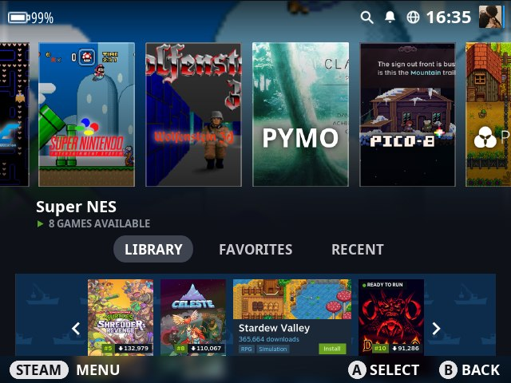
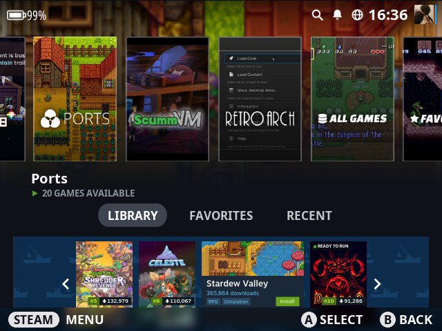
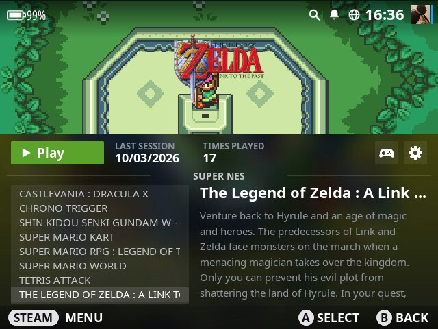
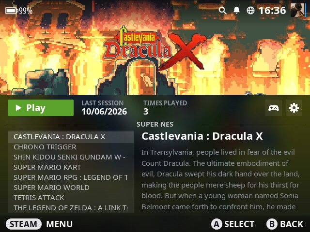
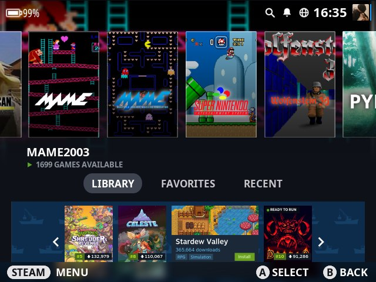
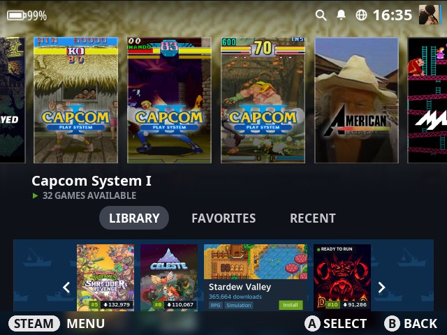
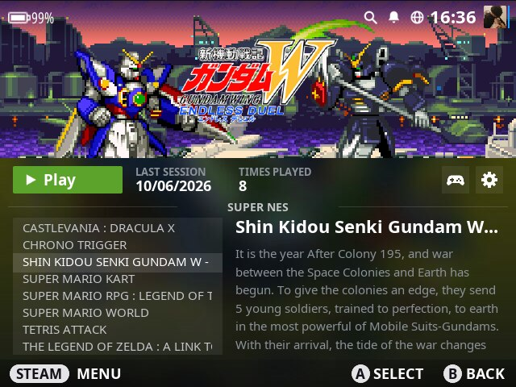

# es-theme-steamdeck

**EN** · [BR](README.pt-BR.md)

 [](LICENSE) [](https://www.reddit.com/user/jovemlcxx/) [](https://ko-fi.com/jovemlcxx)

Steam Deck–style theme for **EmulationStation-fcamod** on the **R36S** and clones (ArkOS family, 640×480), with two optional add-ons: a **boot video** and **UI fixes** (opaque carousel, extra sounds).

<p align="center">
   <br>
   
</p>

[Install](#install) · [Theme](#the-theme) · [Boot video](#boot-video) · [UI Fixes](#steam-deck-ui-fixes) · [Compatibility](#compatibility) · [Customize](#customize)

## Install

Download the zip of **your** system from the [Releases page](https://github.com/jovemlcxx/es-theme-steamdeck/releases/latest):

| Your system | Zip |
|---|---|
| ArkOS | `es-theme-steamdeck-ArkOS.zip` |
| arkos4clone | `es-theme-steamdeck-arkos4clone.zip` |
| dArkOS4Clone | `es-theme-steamdeck-dArkOS4Clone.zip` |
| dArkOS | `es-theme-steamdeck-dArkOS.zip` |
| dArkOSRE-R36 | `es-theme-steamdeck-dArkOSRE-R36.zip` |
| dArkOSen | `es-theme-steamdeck-dArkOSen.zip` |

Extract it and copy each folder to the SD-card partition with the same name:

```
BOOT/                            -> boot partition
├── boot.mp4                        boot video (not in the dArkOS zip: it does not work there)
└── logo.bmp                        boot logo
EASYROMS/                        -> games partition (/roms)
├── themes/es-theme-steamdeck/      the theme
└── tools/                          this system's scripts:
    ├── Enable / Disable Boot Video.sh
    ├── Enable Steam Deck UI Fixes (<system>).sh
    └── Disable Steam Deck UI Fixes.sh
```

1. **START → UI Settings → Theme Set → es-theme-steamdeck**. Dark/light is in the same menu.
2. Optional: run the scripts from **Options → Tools** (see [Boot video](#boot-video) and [UI Fixes](#steam-deck-ui-fixes)).

The repo has the same files unzipped (`BOOT/`, `EASYROMS/` with what every system shares, and `UI Fixes/<system>/` with each system's installer). The zips are not committed: they live on the Releases page, and `python src/make-zips.py` rebuilds them.

## The theme

- One **same-size vertical capsule** per system (192×288, 2:3, as in the Steam library): an in-game screenshot of the platform's best-known game, the system's own logo and a thin outline. 310 systems plus the 3 collections have one. The 21 with no screenshot anywhere (obscure computers and homebrew) get Steam's grey card with the logo.
- The selected capsule is the page background, blurred and fading to the page color. Game list laid out like the Deck's game page: image on top, PLAY, last session, times played, list and description.
- Dark and light schemes. For now the theme is focused on the **R36S, 4:3 (640×480)**; other screen aspect ratios are planned and coming soon.
- **27 languages** (same as the XMB theme): footer, tabs, labels, dates and the PortMaster banner.
- Steam Deck UI sounds. Navigation plays on any ES; select/back/launch/favorite need the UI Fixes.

<p align="center">
    
</p>

## Boot video

`Enable Boot Video.sh` plays `boot.mp4` (from `/boot`, or `/flash`) after the boot logo and before EmulationStation, and hides the boot terminals and the text cursor. `Disable Boot Video.sh` undoes it.

| System | Method |
|---|---|
| ArkOS, arkos4clone, dArkOSen, dArkOSRE-R36 | systemd service `bootvideo.service`; `boot.ini` gets `vt.color=0x00 vt.global_cursor_default=0` (backup `boot.ini.bak-bootvideo`); the "Welcome to…" screen of the lcdyk clones is skipped while the video exists. `ffmpeg` decodes straight to `/dev/fb0` (no window, no mouse cursor), `ffplay`/`mpv` as fallback |

The script also contains code for other systems, but only the ones in the compatibility table below are confirmed. Tip: 640×480, H.264, a few seconds.

## Steam Deck UI Fixes

The ES of this family draws unselected carousel items at a fixed 50% opacity and ignores most theme sounds. The UI Fixes install a patched EmulationStation that adds `unselectedOpacity` to `<carousel>` (the theme uses `1`, so capsules are fully opaque), plays the `select`, `back`, `favorite` and `quicksysselect` sounds, keeps the ScreenScraper scraper, and shows a small logo on the loading screen. `Disable Steam Deck UI Fixes.sh` restores the original (kept as `emulationstation.orig-xmbsounds`).

*These add-ons are optional and reversible: they keep a backup, can be undone anytime with `Disable Steam Deck UI Fixes.sh`, and each build only runs on the system it was made for. The theme itself works fine without them — use them if you'd like the extra polish, at your own choice.*

**One installer per system.** Each R36S distro ships its *own* EmulationStation (different menus, Wi-Fi and hardware integration), so there is a separate build for each, made from that distro's own ES source and changing only the two features above — nothing else. The zip of your system already has the right one in `EASYROMS/tools`: run **Enable Steam Deck UI Fixes (your system)** from **Options → Tools**.

Each installer checks the EmulationStation already on the device and **refuses to run if it is not the one it was built for**, so running the wrong file changes nothing. It also checks the architecture and shared libraries first. An OS update that replaces ES undoes the fix — just run the installer again.

<details><summary>Build from source</summary>

Sources (`src/ui-fixes` has the two patches + `build.sh`/`pack.sh`). Each system is built from its own ES fork, in a Debian 10 arm64 Docker container (old glibc):

| System | ES source |
|---|---|
| arkos4clone | [lcdyk0517/EmulationStation-fcamod](https://github.com/lcdyk0517/EmulationStation-fcamod) `dev` |
| dArkOS, dArkOSRE, ArkOS | [christianhaitian/EmulationStation-fcamod](https://github.com/christianhaitian/EmulationStation-fcamod) `503noTTS` |
| dArkOSen | [djparentx/EmulationStation-fcamod-dArkOS-EN](https://github.com/djparentx/EmulationStation-fcamod-dArkOS-EN) |

Each system has a `src/ui-fixes/systems/<system>/system.env` (`arkos`, `arkos4clone`, `darkos`, `darkosre`, `darkosen`) with its name and the guard strings. Clone the ES source into `src/`, then build and pack, e.g. for dArkOS:

```bash
git clone --recursive -b 503noTTS https://github.com/christianhaitian/EmulationStation-fcamod.git src/EmulationStation-fcamod-chmod
bash src/ui-fixes/build.sh EmulationStation-fcamod-chmod darkos   # applies both patches, compiles (~10-15 min)
bash src/ui-fixes/pack.sh darkos                                  # -> src/tools/Enable Steam Deck UI Fixes (dArkOS).sh
```
Scraper credentials (optional) go in `src/ui-fixes/scraper.env`. Sources, binaries and credentials are git-ignored.
</details>

## Compatibility

What has actually been tested, and how:

| | Theme | Boot video | UI Fixes |
|---|---|---|---|
| dArkOS4Clone | ✅ | ✅ | ✅ |
| dArkOSen | ✅ | ✅ | ✅ |
| ArkOS | ☑️ | ☑️ | 🧪 |
| dArkOS | ☑️ | ❌ does not work | 🧪 |
| arkos4clone | ☑️ | ☑️ | 🧪 |
| dArkOSRE-R36 | ☑️ | ☑️ | 🧪 |
| muOS | ❌ does not work | – | – |
| ArchR, Batocera, Knulli, EmuELEC | not tested yet | not tested yet | not tested yet |

- ✅ **Validated on real hardware** with the current release: theme, boot video, the UI Fixes installer (menus intact, opaque capsules, scraper) and Disable.
- ☑️ **Reported working by testers** on an earlier release. Not re-tested on the current one.
- 🧪 **Built and checked offline, waiting for feedback.** The installer for that system exists and passed the checks below, but it has not been run on that system yet. The previous (single) UI Fixes build was reported working on ArkOS and dArkOS; this one is a new per-system build.

<details><summary>What was checked offline for the 🧪 builds</summary>

- Each installer carries exactly the build made from that distro's own ES source (hash-checked), with the ScreenScraper scraper compiled in.
- Each installer's guard accepts only the ES of its own family and refuses the others (tested against the published ES of dArkOSRE-R36, dArkOS-G80CA-RE, dArkOSen and arkos4clone).
- The binaries need GLIBC 2.17 or older, and the installer checks the architecture and the shared libraries on the device before changing anything.
- ArkOS, dArkOS and dArkOSRE-R36 share the same ES build (christianhaitian `503noTTS`). The ArkOS match is a best effort: if your ArkOS has a different ES, the installer refuses and changes nothing.
</details>

Other limits: only 640×480 (4:3) for now, other aspect ratios are coming soon; tabs, STEAM pill and banner are decorative; a few screenshots are weak (Lynx, Kodi); the light scheme is less tested than the dark one.

### Help test your system

If you use one of the 🧪 systems, running the installer for your system **is** the test. If anything looks wrong, run **Disable Steam Deck UI Fixes** first: it restores the original EmulationStation.

**What to tell me**

1. System, version and device model.
2. Whether `Enable Steam Deck UI Fixes (<your system>)` ran, or refused (copy the message it shows).
3. After it: are Wi-Fi, Bluetooth and the other menus still there? Are the capsules opaque? Does **SCRAPER → SCRAPE NOW** run without restarting EmulationStation?
4. Whether `Disable Steam Deck UI Fixes` brings the original back.

**Where to send it** (either one works)

- 💬 **[Open an issue](https://github.com/jovemlcxx/es-theme-steamdeck/issues)** on this repository: public, so other users of the same system can see it.
- 📩 **[Message me on Reddit](https://www.reddit.com/user/jovemlcxx/)** (u/jovemlcxx): private, if you prefer.

## Customize

Files are named after the system's `<theme>` entry in `es_systems.cfg` (e.g. `snes`, `megadrive`), not the ROM folder. All paths are inside `_inc/`.

| What | Where | Size |
|---|---|---|
| Capsule | `systems/capsule/<theme>.png` | 192×288 (2:3, larger is fine) |
| Game-list background (dark / light) | `systems/gl/` · `gl-light/` | 640×480 |
| Part under the game image | `systems/glinfo/` · `glinfo-light/` | 640×284 |
| Banner (all systems, per language) | `images/banner-portmaster[-<lang>].png` | 1202×274 |
| Banner (one system) | `systems/banner/<theme>.png` | 1202×274 |
| Avatar | `images/avatar.png` | 96×96 |
| Colors | `colors/dark.xml`, `light.xml` | |
| Translations | `lang/<code>.xml` | |

To replace a grey capsule, drop your own PNG with the system's name in `systems/capsule/`. Layout is in `aspect-ratio-4-3.xml`; English texts are the `variables` at the top of `theme.xml` (fcamod stops reading `variables` blocks at the first one of another language, so each translation is its own file).

## Credits and license

**Testing:** huge thanks to [Sabrina Broch](https://www.youtube.com/@sabrinabroch1/videos), a beloved YouTuber of the Brazilian R36S community, who generously tested the theme, the boot video and the first UI Fixes build on several systems. This project would not have been confirmed on so many systems without her help. Go check out her channel!

**License:** [CC BY-NC 4.0](LICENSE)

**Support:** if this theme is useful to you, you can support my work on [Ko-fi](https://ko-fi.com/jovemlcxx). Thank you! ☕

[](https://ko-fi.com/jovemlcxx)
