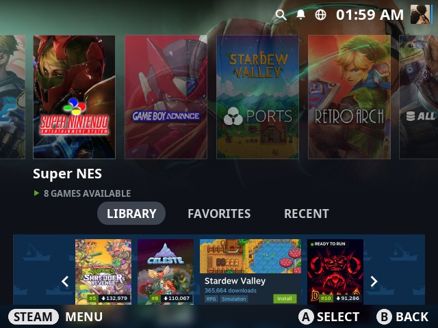
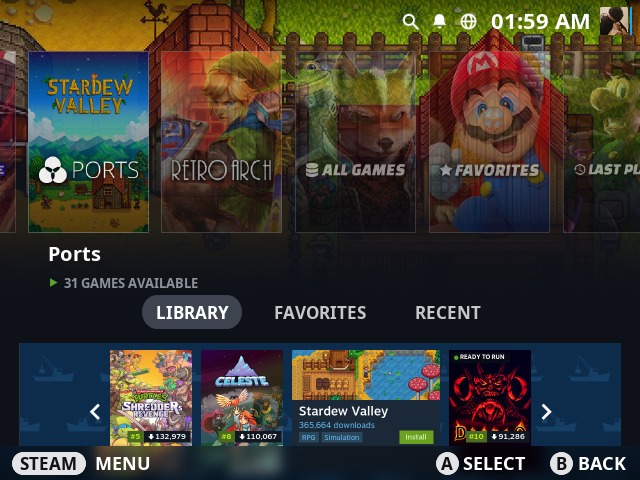
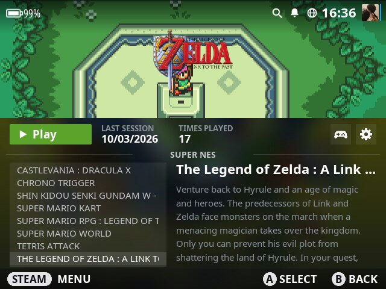
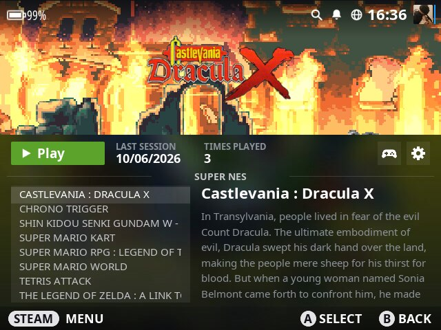
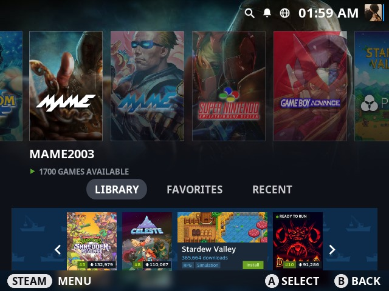
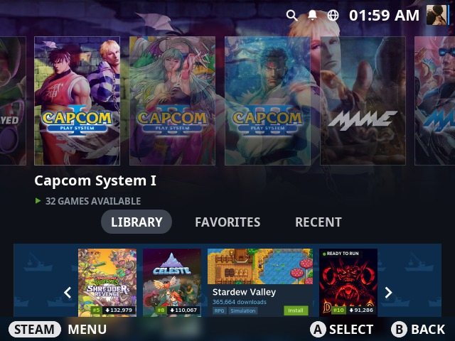
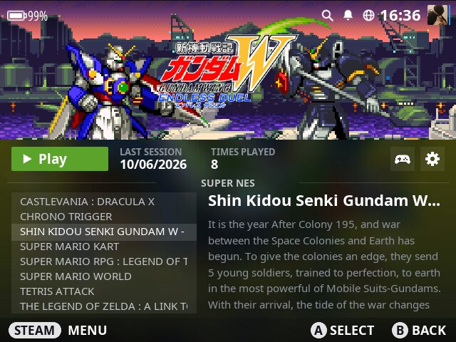

# es-theme-steamdeck

**EN** · [BR](README.pt-BR.md)

   

Steam Deck–style theme for **EmulationStation-fcamod** on the **R36S** and clones (ArkOS family, 640×480).

    
   

[Install](#install) · [Theme](#the-theme) · [Compatibility](#compatibility) · [Customize](#customize)

## Install

Copy the `es-theme-steamdeck` folder (clone this repository or download it as a zip) to the themes folder of your console, `/roms/themes/` (the `themes` folder of the games partition), so that `theme.xml` ends up in `themes/es-theme-steamdeck/theme.xml`.

Then **START → UI Settings → Theme Set → es-theme-steamdeck**. Dark/light, the system view and the language options are in the same menu (**Theme Settings**).

The repository holds only the theme: no scripts, installers or patched EmulationStation.

## The theme

- One **same-size vertical capsule** per system (192×288, 2:3, as in the Steam library): the system's artwork from the [ARTFLIX](https://github.com/fagnerpc/Alekfull-ARTFLIX) theme, the system's own logo and a thin outline. Systems with no artwork there get Steam's grey card with the logo.
- **System view** option (Theme Settings): *Full* (capsules, name, Library/Favorites/Recent tabs and the banner) or *Carousel only* (just the larger capsules and the system name).
- The selected capsule is the page background, blurred and fading to the page color. Game list laid out like the Deck's game page: image on top, PLAY, last session, times played, list and description.
- Dark and light schemes. For now the theme is focused on the **R36S, 4:3 (640×480)**; other screen aspect ratios are planned and coming soon.
- **27 languages** (same as the XMB theme): footer, tabs, labels, dates and the PortMaster banner.
- Steam Deck UI sounds, played on any ES for navigation and launch.

    

## Compatibility

What has actually been tested:

| | Theme |
|---|---|
| dArkOS4Clone | ✅ |
| dArkOSen | ✅ |
| ArkOS | ☑️ |
| dArkOS | ☑️ |
| arkos4clone | ☑️ |
| dArkOSRE-R36 | ☑️ |
| muOS | ❌ does not work |
| ArchR, Batocera, Knulli, EmuELEC | not tested yet |

- ✅ **Validated on real hardware** with the current release.
- ☑️ **Reported working by testers** on an earlier release. Not re-tested on the current one.

Limits: only 640×480 (4:3) for now, other aspect ratios are coming soon; tabs, STEAM pill and banner are decorative; the light scheme is less tested than the dark one. The ES of the ArkOS family draws the unselected capsules of the carousel at 50% opacity (the theme asks for 100%, which only ES builds with `unselectedOpacity` honour; Batocera, Knulli, EmuELEC and ArchR do).

## Customize

Files are named after the system's `<theme>` entry in `es_systems.cfg` (e.g. `snes`, `megadrive`), not the ROM folder. All paths are inside `_inc/`.

| What | Where | Size |
|---|---|---|
| Capsule | `systems/capsule/<theme>.png` | 192×288 (2:3, larger is fine) |
| Game-list background (dark / light) | `systems/gl/` · `gl-light/` | 640×480 |
| Part under the game image | `systems/glinfo/` · `glinfo-light/` | 640×284 |
| Banner (all systems, per language) | `images/banner-portmaster[-<lang>].png` | 1202×274 |
| Banner (one system) | `systems/banner/<theme>.png` | 1202×274 |
| Avatar | `images/avatar.png` | 96×96 |
| Colors | `colors/dark.xml`, `light.xml` | |
| Translations | `lang/<code>.xml` | |

To replace a grey capsule, drop your own PNG with the system's name in `systems/capsule/`. Layout is in `aspect-ratio-4-3.xml`; English texts are the `variables` at the top of `theme.xml` (fcamod stops reading `variables` blocks at the first one of another language, so each translation is its own file).

## Credits and license

**Artwork:** the capsule pictures come from the [ARTFLIX](https://github.com/fagnerpc/Alekfull-ARTFLIX) theme by Alekfull / fagnerpc.

**Testing:** huge thanks to [Sabrina Broch](https://www.youtube.com/@sabrinabroch1/videos), a beloved YouTuber of the Brazilian R36S community, who generously tested the theme on several systems. This project would not have been confirmed on so many systems without her help. Go check out her channel!

**License:** [CC BY-NC 4.0](LICENSE)

**Support:** if this theme is useful to you, you can support my work on [Ko-fi](https://ko-fi.com/jovemlcxx). Thank you! ☕

