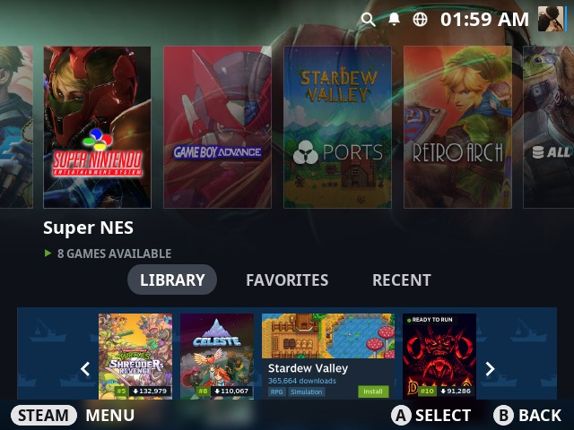
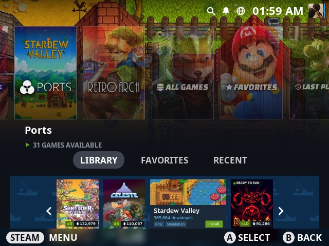
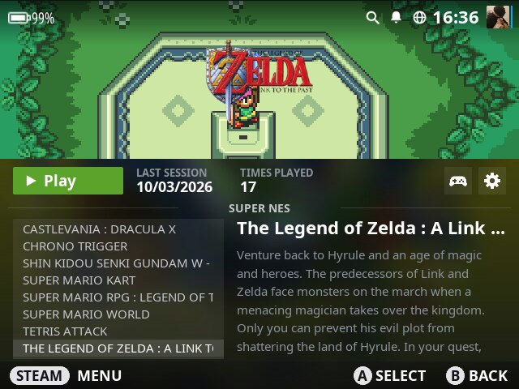
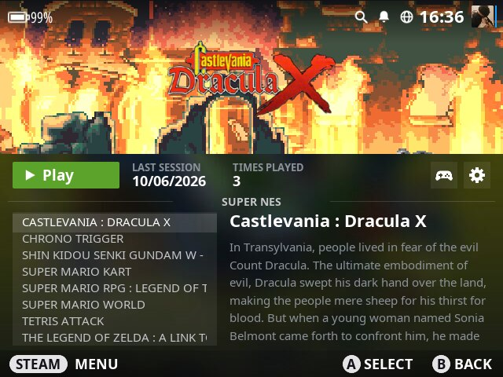
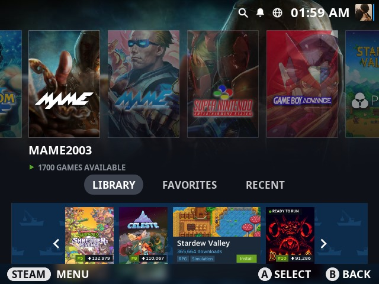
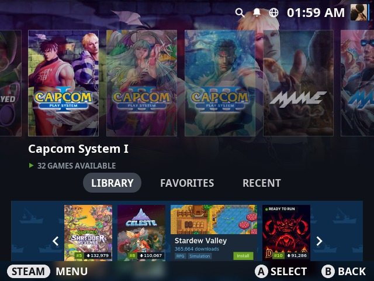
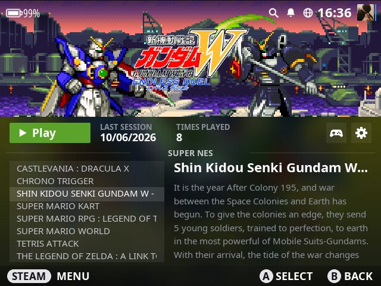

# es-theme-steamdeck

[EN](README.md) · **BR**

   

Tema no estilo do Steam Deck para o **EmulationStation-fcamod** no **R36S** e clones (família ArkOS, 640×480).

    
   

[Instalação](#instalação) · [Tema](#o-tema) · [Compatibilidade](#compatibilidade) · [Personalizar](#personalizar)

## Instalação

Copie a pasta `es-theme-steamdeck` (clone este repositório ou baixe como zip) para a pasta de temas do console, `/roms/themes/` (a pasta `themes` da partição de jogos), de modo que o `theme.xml` fique em `themes/es-theme-steamdeck/theme.xml`.

Depois **START → Configurações de interface → Tema → es-theme-steamdeck**. Escuro/claro, a visão de sistemas e o idioma ficam no mesmo menu (**Configurações do tema**).

## O tema

- Uma **capa vertical de mesmo tamanho** por sistema (192×288, 2:3, como na biblioteca da Steam): a arte do sistema vinda do tema [ARTFLIX](https://github.com/fagnerpc/Alekfull-ARTFLIX), a logo do próprio sistema e um contorno fino. Sistemas sem arte lá usam o cartão cinza da Steam com a logo.
- Opção **Visão de sistemas** (Configurações do tema): *Completa* (capas, nome, abas Biblioteca/Favoritos/Recentes e o banner) ou *Somente carrossel* (apenas as capas maiores e o nome do sistema).
- A capa selecionada é o fundo da página, desfocada e se misturando à cor da página. A lista de jogos segue a página de jogo do Deck: imagem no topo, PLAY, última sessão, vezes jogado, lista e descrição.
- Esquemas escuro e claro. Por enquanto o tema é focado no **R36S, 4:3 (640×480)**; outras proporções de tela estão planejadas e chegam em breve.
- **27 idiomas** (os mesmos do tema XMB): rodapé, abas, rótulos, datas e o banner do PortMaster.
- Sons da interface do Steam Deck, tocados em qualquer ES na navegação e ao iniciar um jogo.

    

## Compatibilidade

O que foi realmente testado:

| | Tema |
|---|---|
| dArkOS4Clone | ✅ |
| dArkOSen | ✅ |
| ArkOS | ☑️ |
| dArkOS | ☑️ |
| arkos4clone | ☑️ |
| dArkOSRE-R36 | ☑️ |
| muOS | ❌ não funciona |
| ArchR, Batocera, Knulli, EmuELEC | ainda não testado |

- ✅ **Validado em hardware real** com a versão atual.
- ☑️ **Relatado como funcionando por testadores** em versão anterior. Não retestado na atual.

Limites: só 640×480 (4:3) por enquanto, outras proporções chegam em breve; abas, pílula STEAM e banner são decorativos; o esquema claro é menos testado que o escuro. O ES da família ArkOS desenha as capas não selecionadas do carrossel com 50% de opacidade (o tema pede 100%, o que só os ES com `unselectedOpacity` respeitam; Batocera, Knulli, EmuELEC e ArchR respeitam).

## Personalizar

Os arquivos têm o nome da entrada `<theme>` do sistema no `es_systems.cfg` (ex.: `snes`, `megadrive`), não o da pasta de ROMs. Todos os caminhos ficam dentro de `_inc/`.

| O quê | Onde | Tamanho |
|---|---|---|
| Capa | `systems/capsule/<theme>.png` | 192×288 (2:3, maior também serve) |
| Fundo da lista de jogos (escuro / claro) | `systems/gl/` · `gl-light/` | 640×480 |
| Parte sob a imagem do jogo | `systems/glinfo/` · `glinfo-light/` | 640×284 |
| Banner (todos os sistemas, por idioma) | `images/banner-portmaster[-<lang>].png` | 1202×274 |
| Banner (um sistema) | `systems/banner/<theme>.png` | 1202×274 |
| Avatar | `images/avatar.png` | 96×96 |
| Cores | `colors/dark.xml`, `light.xml` | |
| Traduções | `lang/<code>.xml` | |

Para trocar uma capa cinza, coloque seu PNG com o nome do sistema em `systems/capsule/`. O layout está em `aspect-ratio-4-3.xml`; os textos em inglês são as `variables` no início do `theme.xml` (o fcamod para de ler blocos `variables` no primeiro de outro idioma, por isso cada tradução é um arquivo próprio).

## Créditos e licença

**Arte:** as imagens das capas vêm do tema [ARTFLIX](https://github.com/fagnerpc/Alekfull-ARTFLIX), de Alekfull / fagnerpc.

**Testes:** um agradecimento enorme à [Sabrina Broch](https://www.youtube.com/@sabrinabroch1/videos), querida YouTuber da comunidade brasileira de R36S, que testou com todo carinho o tema em vários sistemas. Sem a ajuda dela este projeto não estaria confirmado em tantos sistemas. Conheça o canal dela!

**Licença:** [CC BY-NC 4.0](LICENSE)

**Apoie:** se este tema te for útil, você pode apoiar meu trabalho no [Ko-fi](https://ko-fi.com/jovemlcxx). Obrigado! ☕

